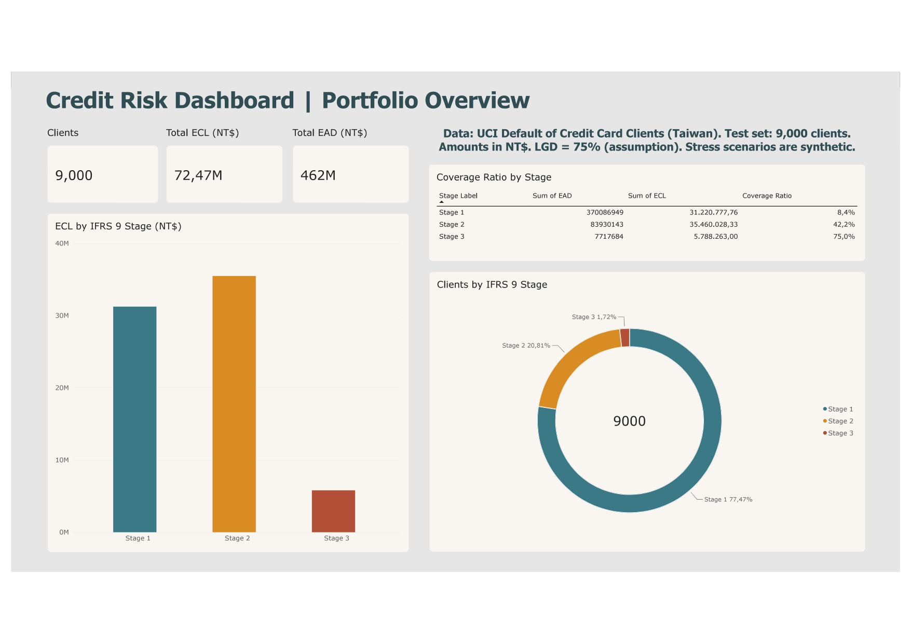
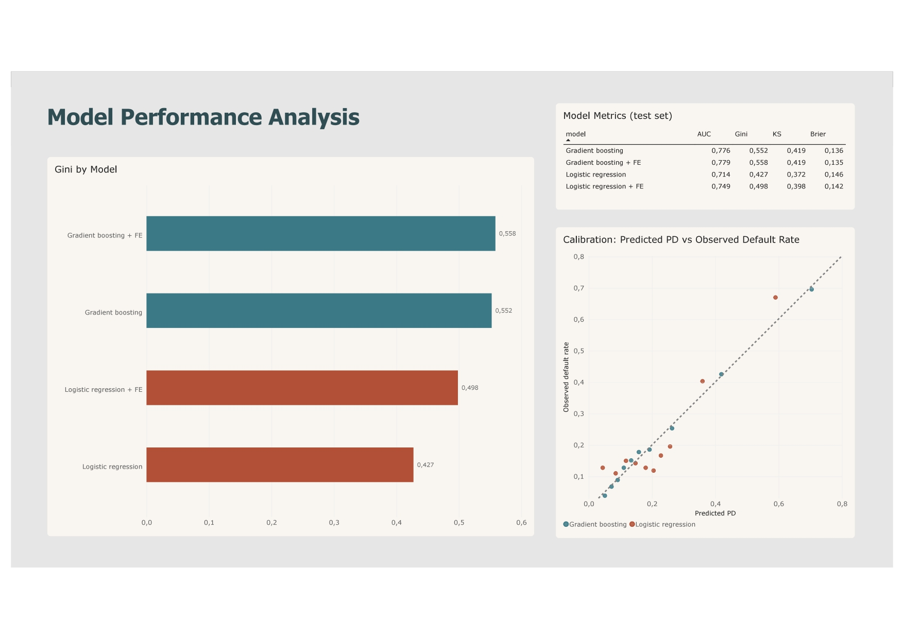
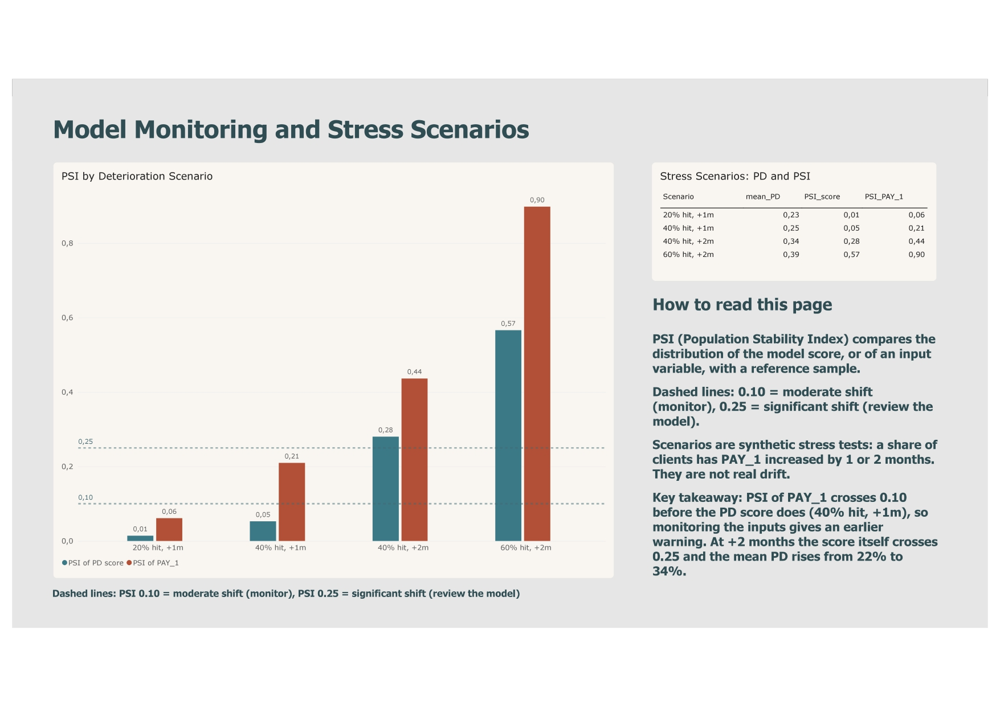

# Credit Risk Modelling: PD Scorecard, IFRS 9 ECL and Monitoring

End-to-end retail credit risk project on a public credit card dataset: probability of default (PD) models, model evaluation, simplified IFRS 9 staging and expected credit loss (ECL), stress scenarios, population stability monitoring and a Power BI dashboard.

## Dashboard

### Portfolio Overview and IFRS 9 Staging

### Model Performance Analysis

### Model Monitoring and Stress Scenarios

The Power BI file is in `dashboard/` and a PDF export is available next to it.

## Dataset

[Default of Credit Card Clients](https://archive.ics.uci.edu/dataset/350/default+of+credit+card+clients) (UCI Machine Learning Repository): 30,000 credit card clients in Taiwan, 23 input variables (credit limit, demographics, 6 months of repayment status, bill amounts and payment amounts) and a binary target, default in the next month. The default rate is 22.1%.

Data cleaning:
- Columns renamed from X1-X23 to descriptive names (LIMIT_BAL, PAY_1, BILL_AMT1, ...).
- Undocumented codes in EDUCATION (0, 5, 6) merged into "other" (4), and MARRIAGE code 0 merged into "other" (3).
- No missing values were found.
- SEX is excluded from all models, because gender is not an acceptable scoring variable in European retail credit.

## Methodology

1. **Split:** 70/30 stratified train/test split (21,000 / 9,000 clients), fixed random seed, same default rate in both sets.
2. **Models:** logistic regression (standardised inputs) as the interpretable baseline, and gradient boosting (scikit-learn `HistGradientBoostingClassifier`) as the benchmark.
3. **Feature engineering:** maximum delay and number of late months over 6 months, credit utilisation (latest and average), and repayment ratio (paid / billed).
4. **Evaluation:** AUC, Gini, KS statistic, Brier score and calibration curves, all on the test set.
5. **Explainability:** SHAP values for the gradient boosting model, explaining the predicted PD.
6. **IFRS 9 (simplified):** staging rules and ECL = PD x LGD x EAD.
7. **Monitoring:** Population Stability Index (PSI) of the PD score and of the input variables, plus synthetic deterioration scenarios.

## Results

### Model performance (test set, 9,000 clients)

| Model | AUC | Gini | KS | Brier |
|---|---|---|---|---|
| Logistic regression | 0.714 | 0.427 | 0.372 | 0.146 |
| Logistic regression + engineered features | 0.749 | 0.498 | 0.398 | 0.142 |
| Gradient boosting | 0.776 | 0.552 | 0.419 | 0.136 |
| Gradient boosting + engineered features | 0.779 | 0.558 | 0.419 | 0.135 |

- Gradient boosting separates good and bad clients clearly better than the baseline.
- Feature engineering lifts the logistic regression Gini by about 0.07, closing roughly half of the gap to gradient boosting. For gradient boosting the change is negligible (+0.006 Gini, same KS), because it already finds these interactions from the raw columns.

### Calibration

- Both models are well calibrated on average: mean predicted PD is 0.221 (logistic regression) and 0.220 (gradient boosting) against an observed default rate of 0.221.
- Gradient boosting follows the observed default rate closely across 10 equal-sized PD bins (for example 0.704 predicted vs 0.696 observed in the riskiest bin) and has the lower Brier score.
- Logistic regression underestimates risk in the lowest bin (4.4% predicted vs 12.8% observed) and overestimates it in the middle of the range.

### Explainability

SHAP values show that the most recent repayment status (PAY_1) is by far the strongest driver of the predicted PD (mean absolute SHAP of about 0.08), followed by the credit limit (LIMIT_BAL). The other variables contribute much less individually.

### IFRS 9 staging and expected credit loss (simplified)

| Stage | Clients | Mean PD | Total EAD (NT$) | Total ECL (NT$) | Coverage |
|---|---|---|---|---|---|
| 1 | 6,972 | 13.8% | 370.1M | 31.2M | 8.4% |
| 2 | 1,873 | 48.5% | 83.9M | 35.5M | 42.2% |
| 3 | 155 | 70.8% | 7.7M | 5.8M | 75.0% |

Total ECL is 72.5M on 461.7M of exposure (15.7%). Stage 2 clients carry about half of the total ECL with less than a fifth of the exposure. Mean PD and observed default rate rise together from Stage 1 to Stage 3.

### Monitoring: PSI and stress scenarios

- Train vs test PSI is 0.0014 for the PD score and below 0.003 for every input variable, as expected for a random split.
- In synthetic deterioration scenarios (a share of clients gets PAY_1 increased by 1 or 2 months), the PSI of PAY_1 crosses the 0.10 warning level before the PSI of the PD score does (40% of clients, +1 month: 0.21 vs 0.05).
- With +2 months for 40% of clients, the score PSI reaches 0.28 (above the 0.25 alert level) and the mean PD rises from 22% to 34%.
- This shows why input variables should be monitored together with the score.

## Assumptions and limitations

- **Public dataset, not a bank portfolio.** The data are credit card clients in Taiwan, with a 22% default rate and amounts in NT$. A real retail portfolio would have a much lower default rate, so the ECL levels and stage sizes here are not representative of a bank balance sheet.
- **No out-of-time validation.** The dataset has no dates per client, so the test set is a random split and not a later period. A production backtest would be out-of-time. The results come from a single split, so differences in the second decimal should not be over-interpreted.
- **PD horizon.** The target is default in the next month. IFRS 9 requires 12-month PD for Stage 1 and lifetime PD for Stage 2, so the ECL figures are a simplified illustration. Lifetime PD (for example with survival analysis) is a natural next step.
- **IFRS 9 rules are assumptions.** Stage 3 = 3 or more months past due, Stage 2 = 1 to 2 months past due or PD of at least 50% (the SICR threshold is an assumption), Stage 1 = the rest. Stage 3 PD is set to 1, so its 75% coverage equals LGD by construction.
- **LGD and EAD are assumed, not estimated.** LGD is fixed at 75% for unsecured card exposure, and EAD is the latest bill amount (negative balances set to zero).
- **Undocumented codes.** PAY_1 to PAY_6 contain the codes -2, -1 and 0, which are not defined in the dataset documentation. They are kept as ordinal values.
- **Stress scenarios are synthetic.** They add 1 or 2 months to PAY_1 for a random share of clients. They illustrate how PSI reacts and are not real drift.
- **Fairness.** SEX is excluded from the models. EDUCATION and MARRIAGE are kept, and in a real setting their use would need a separate fairness and regulatory review.

## Repository structure

- `notebooks/01_eda.ipynb`: data exploration and correlation heatmap
- `notebooks/02_modelling.ipynb`: models, evaluation, calibration, SHAP, IFRS 9, PSI and stress scenarios
- `outputs/`: tables exported for the dashboard
- `dashboard/`: Power BI file and PDF export
- `images/`: dashboard screenshots